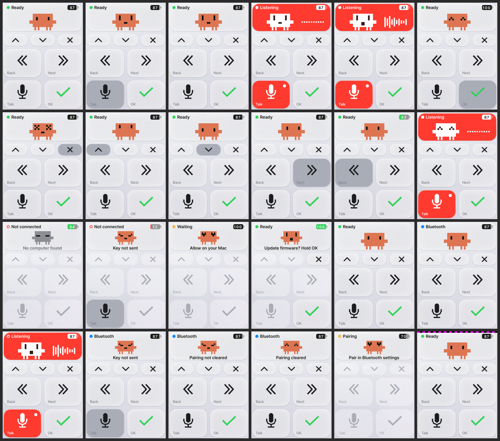

# vibe-stick CoreS3

A remote control for Claude Code — press, then tell it what to do by voice, hands off the keyboard. *(한국어: [README.ko.md](README.ko.md))*

It turns an M5Stack CoreS3 into **a device you tap to give Claude Code instructions by voice**. On one USB cable the Mac sees it as a "keyboard + microphone"; unplug the cable and the buttons carry on as a Bluetooth keyboard. Speech recognition is Claude Code's own dictation (⌘D).


*Every screen, pixel-identical to the device. The icons are plain line art drawn by the art generator script (`cores3/tools/gen_art.py`). The default mascot is unofficial fan art of the Claude Code character and is not covered by MIT — see [Mascot](#mascot).*

*An unofficial hobby project, not affiliated with Anthropic — see [Unofficial](#unofficial).*

## ⚠️ Read first — risks

**Build the firmware yourself from this repository (https://github.com/parkds-claude/vibe-stick-cores3) and never flash a binary from anywhere else** — a modified build is a keyboard that types whatever its author wants. There are no releases or prebuilt firmware. Security notes and how to report a problem: [SECURITY.md](SECURITY.md).

This device **is a keyboard**. It sends Enter, Esc and ⌘D to the computer it is plugged into (or, unplugged, to the computer it is paired with), and Enter **approves** Claude's "may I edit this file?" prompt.

- **Look at the computer's screen before you press.** The device cannot see the computer's screen. With the cursor in an editor (a file), ⌘D and Enter go into the file.
- **Do not plug it into a computer that is not yours.**
- **Pair over Bluetooth in a place you trust.** Pairing has no numeric confirmation, so while the device has no bond (first use, or after you clear it) the first computer to connect becomes its peer.
- **If you lose it, remove `vibe-stick S3` from the Mac's Bluetooth device list.** Nothing on the device is encrypted: whoever holds it can extract the Bluetooth bond key it shares with your Mac, or flash other firmware.
- **If `Update firmware? Hold OK` appears when you did not ask for it, press ✕.** Firmware is replaced only when ✓ is held down.
- **Never leave the development build (`tools/flash.sh --dev`) on a device you use.** It lets any program on the computer make the device type. A development build shows a magenta/black band across the top of its normal screen.
- **Back up the device's original contents before the first flash.** The backup can contain things like the previous firmware's Wi-Fi password. Keep it outside the repository and do not give it to anyone.

More detail: "보안에 대해 알아 둘 것" in [docs/사용법-cores3.md](docs/사용법-cores3.md) (Korean) and [SECURITY.md](SECURITY.md).

## At a glance

- **A remote control for Claude Code.** Press, then tell it what to do by voice — no keyboard. Unplug the cable and it carries on over Bluetooth (then only the button presses are sent).
- **Press, then say it.** With the cursor in Claude Code's input box, what you say is transcribed by Claude Code in VS Code. Press OK and it is sent as is.
- **"May I edit this?" — answer with your thumb.** Read the prompt on the Mac's screen: OK to allow, ✕ if not. No reaching for the keyboard.
- **Unplugged, and pressed from a distance.** The author tried it from 20 m away and the button presses still got through. The prompt is not shown on the device, though — look at the Mac's screen before you press. (Range varies with the surroundings.)
- **Plug it in and the device is the microphone.** Pick `vibe-stick mic` as the Mac's sound input and you speak into the device — even on a Mac with no microphone. Over Bluetooth, the listening is done on the Mac's side — its own microphone or your earphones.
- **Meet the little square: an M5Stack CoreS3.** A 54 mm square with a 2-inch touch screen; microphone and speaker built in. The 500 mAh battery sits in the base on the back — the DinBase the CoreS3 ships with has one, and the author's unit has the thinner M5GO Battery Bottom3 (also 500 mAh) there instead. (Not tried on the CoreS3 SE, which has no battery.)
- **Seven places to press on the screen.** Four large tiles — Talk · OK · Back · Next — and three small ones above them: ▲ · ▼ · ✕ (up, down, cancel).
- **And this remote is open source** (MIT, except the default mascot — see [Mascot](#mascot)). No soldering: build the firmware yourself from this source and flash it (no prebuilt firmware is published). How to build it: [docs/사용법-cores3.md](docs/사용법-cores3.md) (Korean).

## Controls


Hold it upright in the left hand and press with the thumb. The USB cable leaves from the top.

| Where you press | Key sent | In Claude |
|---|---|---|
| **Talk** (bottom left) | ⌘D | Dictation. Press once to start listening, again to stop |
| **OK** (bottom right, ✓) | Enter | Send · allow · confirm a choice |
| **Back · Next**, short press | F17 · F18 | To the neighbouring panel of the same VS Code window (needs two shortcut lines in VS Code) |
| **Back · Next**, long press (0.6 s) | ⇧⌘\` · ⌘\` | To another window of the same app |
| **▲ ▼** | ↑ ↓ | Move between choices. Hold to keep moving |
| **✕** | Esc | Cancel · deny · stop the running task. At most once per second |
| **OK + ✕** for 3 s | — | Clear the Bluetooth pairing |
| Tap the top panel (the mascot) | — | Only flips the red "listening" indicator |

First-time setup (choosing the sound input, the two shortcut lines), what the screen tells you, using it without the cable, and getting Claude's notifications (Korean): [docs/사용법-cores3.md](docs/사용법-cores3.md)

## Assumptions and limitations

- **Mac only.** The flashing tools are for macOS, and the keys sent are the Mac shortcuts (⌘D · ⌘\`). You need VS Code with the Claude Code extension, with voice dictation (⌘D) working.
- **Sound from the device's microphone travels over the cable only.** When wireless, you speak into the Mac's microphone or your earphones. On the cable, too, your voice goes in through the device only after you pick `vibe-stick mic` under System Settings > Sound > Input — and while it is picked, other programs on the Mac (video calls and so on) listen through this microphone as well.
- **The red "listening" indicator comes in two forms.** A filled white dot is fact (the Mac has opened this device's microphone); a hollow ring is a guess (you pressed Talk, but the Mac did not open this microphone). The guess can drift from reality — tap the top panel (the mascot) to make it match the dictation indicator on the Mac's screen.
- **Built and verified on the M5Stack CoreS3.** Not tried on the CoreS3 SE, which has no battery.
- **Korean inside.** The usage guide, the code comments and the messages the tools print are in Korean.

## Parts and flashing

- An **M5Stack CoreS3** ([official docs](https://docs.m5stack.com/en/core/CoreS3)) and a data-capable USB-C cable. No soldering.
- macOS, VS Code + the Claude Code extension
- [ESP-IDF](https://docs.espressif.com/projects/esp-idf/en/v5.5.4/esp32s3/get-started/) 5.5.x (built and verified with v5.5.4). `tools/flash.sh` looks for it at `~/esp/esp-idf-5.5.4`; if yours is elsewhere, edit that line in the script — otherwise it exits without a message.

```
cd cores3 && source ~/esp/esp-idf-5.5.4/export.sh
python tools/backup.py ~/cores3-original.bin    # before the first flash: back up the device's original contents in full
tools/flash.sh                                  # build and flash (the normal build)
```

**Do not go by these three lines alone.** Follow "빌드하고 올리기" in [docs/사용법-cores3.md](docs/사용법-cores3.md) (Korean), which walks through it in order: writing down your own device's MAC, download mode (hold RST for 3 s), verifying the backup, and — from the second time on — accepting an update by holding ✓ on the screen.

After flashing: plug it in over USB with the Mac unlocked, and a green dot and `Ready` appear at the top. Pick `vibe-stick mic` under System Settings > Sound > Input.

## Structure

| Where | Role |
|---|---|
| `cores3/main/` | The layer that touches the hardware: USB (keyboard · microphone · log port), touch and screen, microphone, sensors, sound |
| `cores3/logic/` | Pure, hardware-free code — deciding what a press means, screen state and drawing, and the gates that decide whether a press may be accepted right now. Tested on the host |
| `cores3/tools/` | Flashing (`flash.sh`), backup (`backup.py`), finding the device · commands · logs (`vibectl.py`), Claude notifications (`claude_note.py`), generating the screen art (`gen_art.py`) and more |
| `cores3/test/host/` | Host tests and the screen preview |
| `src/` | Code shared with the [joystick build](https://github.com/parkds-claude/vibe-stick-public): input → events → keys (`logic/input_logic.*` · `keymap.*` · `dispatch.*`), the Bluetooth keyboard (`ble_hid.*`), mascot pixel art (`logic/pixel_art.*`) |
| `test/host/check.h` | The small CHECK/RUN macros the host tests use (shared with the joystick build) |

Design decisions are recorded in code comments as `D<number>` with reason, cost and how to revert.

## Development

```
sh cores3/test/host/run.sh        # host tests (no device needed): presses · screen · gates / USB descriptors / Python tools
sh cores3/test/host/preview.sh    # render every screen → docs/design/cores3-screens.png (overwrites it; pixel-identical to the device)
```

The USB descriptor check runs only after `cores3` has been built at least once (so that its components are downloaded), and the Python tool tests run only if that python3 has pyserial; otherwise each says it was skipped.

Run both from the repository root, in a git clone: one tool test asks git whether `*.part` files are ignored, so it fails in a copy without `.git` (a downloaded ZIP).

## Mascot

The default mascot is an **unofficial pixel-art rendition of the Claude Code character**, made by the author for personal use. **It is not covered by the MIT license** — rights remain with Anthropic, it is not endorsed by them, and it will be removed on request (it also stays in this repository's git history until then). **Do not use it commercially or in hardware you sell or distribute**; build with one of the original mascots instead. Five original mascots (MIT) are included and selectable at build time.

| Name | Build value | Look |
|---|---|---|
| Claude (default) | `Claude` | unofficial fan art |
| Cat | `Cat` | black cat |
| Stick | `Stick` | arcade joystick |
| Keycap | `Keycap` | a key that escaped the keyboard |
| Robot | `Robot` | robot with an antenna |
| Sprout | `Sprout` | mochi with a sprout |

To change it, run `idf.py -B build -DMASCOT=Cat reconfigure` once in `cores3/`, then flash with `tools/flash.sh`. Mascot data is a character grid in `src/logic/pixel_art.cpp`, so drawing your own is easy. All six — the five originals and the default — drawn on the joystick build's screen: [docs/design/mascots.png](docs/design/mascots.png) (the bottom row is the default fan-art mascot, not MIT).

(The comments in `src/logic/pixel_art.h` mention `-DMASCOT_ID=…` and `test/host/preview.sh`; those are the joystick build's way. Here the switch is `-DMASCOT=…` — `idf.py -DMASCOT_ID=…` does not reach the compiler and you get the default mascot.)

## The joystick build

The same idea built on an M5StickC Plus with the Mini JoyC HAT (a joystick) is a separate project: https://github.com/parkds-claude/vibe-stick-public

## Unofficial

An independent hobby project, not affiliated with, endorsed by or sponsored by Anthropic (Claude, Claude Code), M5Stack, Apple or Microsoft (VS Code). Trademarks belong to their owners. Third-party notices and the mascot exception: [NOTICE](NOTICE). License for the code and the five original mascots: [MIT](LICENSE).
